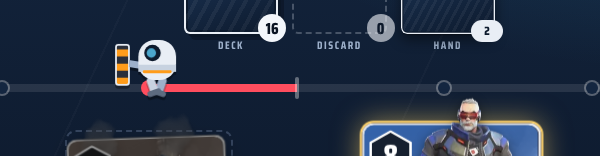

# Payload Push

A small, fast hero card battler inspired by Overwatch. Pick a deck of heroes, play one card a round, and push the robot toward the enemy base. No mana, no HP, no shops: just Power, abilities, and a single Reserve slot.

> **Fan project.** Not affiliated with or endorsed by Blizzard Entertainment. Overwatch and its heroes, art and voice lines belong to Blizzard.



## Play it

- **Quickest:** download `payload-push-standalone.html` and open it in any browser. Everything (cards, art, voices) is inside that one file.
- **Installable web app:** serve the `web/` folder from any static host (GitHub Pages, itch.io, Netlify). It works offline and can be added to a phone home screen.

## Game modes

| Mode | Style | Status |
|---|---|---|
| **Push** | Casual 1v1. Each round both players reveal a hero; the higher Power wins and the robot walks one step toward the loser's base. Reach their base, or be ahead after 20 rounds, to win. | Live |
| **Control** | Competitive. A 7×7 grid with simultaneous reveals, flipping, line bonuses and bonus tiles over 3 rounds. | Beta |
| **Payload** | Single-player roguelike: escort the payload through ~10 rounds against escalating enemies. | Planned |

### Push rules in short

- Every hero has a **Power** value and an ability.
- You hold a hand and one **Reserve** slot. Synergies key off your Reserve, cards already played, and where the robot is.
- Some heroes come as two cards (D.Va: pilot + mech; Wrecking Ball).
- Tracer returns to your Reserve with +1 Power when she loses.
- The game ends when the robot reaches a base or after 20 rounds (the side the robot is on decides; dead centre is a draw).

All 46 heroes are in the roster, with starter decks for learning and a deck builder for custom decks. Online play uses PeerJS (peer-to-peer).

## Project layout

```
payload-push-standalone.html   Built game, single file
web/                           Built installable web app (PWA)
src/                           Game source: engine.js, game.js, control.js, net.js, style.css, body.html ...
art-src/                       Source art (hero cutouts, skins) and voice lines
build.py                       Bundles src/ into the standalone file and web/
make_portraits.py, cut_skins.py   Turn art-src/ images into src/portraits.js
make_voices.py                 Turns art-src/voice/ into src/voices.js
make_music.py                  Builds menu music from art-src/music/ (not included, see below)
make_battle_music.py           Synthesises the original in-game battle track
docs/research/                 Control mode design notes, simulators and balance tools
docs/screenshots/              Screenshots
```

## Building

Requires Python 3 (Pillow, numpy and scipy for the art and music scripts), Node.js for `make_voices.py`, and ffmpeg for audio.

```bash
python build.py            # rebuilds payload-push-standalone.html and web/
python make_portraits.py   # only after changing art in art-src/
```

## Music

The in-game battle track (`src/music/battle.mp3`) is original and synthesised by `make_battle_music.py`. The menu music uses commercial songs, so those files are **not** in this repo. To use your own, put the songs in `art-src/music/` and run `python make_music.py`, or drop `<song>-inst.mp3` / `<song>-full.mp3` files into `web/music/`. The game plays silently on the menu when they are missing.
